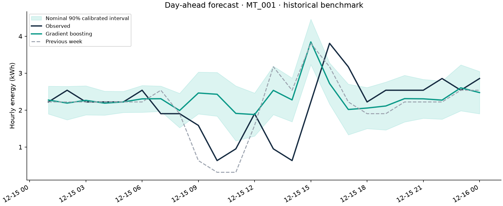
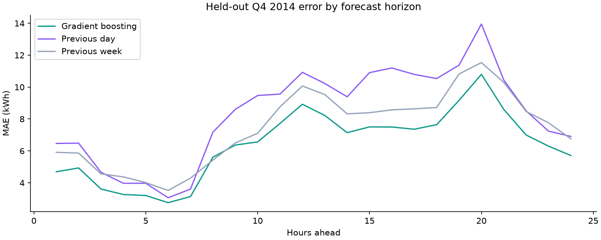
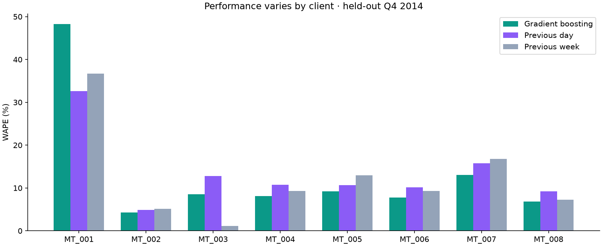

# WattScope

**Day-ahead electricity forecasting with reproducible experiments, calibrated uncertainty, and a working API.**

WattScope predicts the next 24 hourly energy readings for eight predetermined clients from the original UCI electricity dataset. It compares a pooled gradient-boosting model with previous-day and previous-week seasonal baselines, then serves the frozen model through a FastAPI dashboard.

This is a **historical benchmark**, not a live energy feed. Every reported result is computed from real held-out observations. The source, methodology, tests and artifacts are available for inspection.



## What this project demonstrates

- Converting quarter-hour power readings into correctly labeled hourly energy.
- Building direct multi-horizon features that cannot read observations after the forecast origin.
- Keeping training, parameter selection, calibration and final testing chronologically separate.
- Comparing against meaningful seasonal baselines and reporting errors per client, month and horizon.
- Serving exactly the same fitted model and feature code used in the experiment.
- Documenting uncertainty, reproducibility and limits rather than inventing performance claims.

## Quick start

Use Python 3.12, the tested reference environment. The repository includes the processed subset, fitted model and measured report, so the dashboard does not require a fresh download or training run.

```bash
python -m venv .venv
# Windows PowerShell: .venv\Scripts\Activate.ps1
# macOS/Linux: source .venv/bin/activate
python -m pip install -r requirements.lock
python -m pip install --no-deps -e .
python -m wattscope.cli serve
```

Open <http://127.0.0.1:8000> for the dashboard and <http://127.0.0.1:8000/docs> for the interactive API documentation. The default view is a forecast issued on 15 December 2014 at midnight; later observations are shown only for comparison.

## Reproduce the experiment

```bash
# Optional: rebuild the supplied subset from the original UCI archive (~249 MB).
python -m wattscope.cli prepare

# Select parameters, refit, calibrate, then evaluate the frozen model.
python -m wattscope.cli train

# Run the leakage, data conversion, metric and API checks.
pytest -q
ruff check .
```

You may reuse a downloaded original ZIP with `python -m wattscope.cli prepare --archive path/to/electricity.zip`. Raw data is ignored by Git. The prepared data is small enough to distribute and retains its source attribution.

## Evaluation design

All origins are midnight in the dataset's original normalized Portuguese local clock. An hourly label describes the interval ending at that timestamp. Features use the preceding 168 complete hourly observations and known calendar information. For target `origin + h`, with `h <= 24`, the lags `target - 24`, `target - 48` and `target - 168` are already available at the origin.

| Stage | Daily forecast origins | Use |
| --- | --- | --- |
| Initial training | 8 Jan 2013–31 Aug 2014 | Fit three predefined parameter configurations |
| Validation | 1–14 Sep 2014 | Choose the configuration with lowest MAE |
| Final fitting | 8 Jan 2013–14 Sep 2014 | Refit the selected configuration; labels end on 15 Sep at 00:00 |
| Calibration | 16–29 Sep 2014 | Estimate horizon-specific residual interval widths |
| Final test | 1 Oct–31 Dec 2014 | Evaluate the unchanged model in three monthly slices |

At each test origin, already observed test readings may enter the feature history. They never enter model fitting. This mirrors daily operation with a frozen model; it is not a 92-day forecast issued all at once. Random early stopping is explicitly disabled.

## Results and evidence

See [the generated experiment report](reports/EXPERIMENT_REPORT.md) for measured MAE, RMSE, WAPE and interval coverage. [Full results](reports/results.json) include parameter selection, per-client scores, monthly folds, dependency versions and the dataset checksum. [Prediction-level output](reports/predictions.csv.gz) makes the summary metrics auditable.





Pooled WAPE emphasizes higher-volume clients; macro-client and per-client results are reported alongside it. A model may perform differently across clients and months, and no claim of universal superiority is made.

## Prediction intervals

Nominal 90% **pointwise** intervals use finite-sample quantiles of normalized absolute residuals from the separate calibration window, independently for each horizon. The fitted model is not changed after calibration. Negative lower bounds are clipped at zero.

Serial correlation and distribution shift mean nominal 90% coverage is not guaranteed. The report includes empirical test coverage and interval width. These are not simultaneous confidence bands for a whole 24-hour path.

## API examples

```bash
curl "http://127.0.0.1:8000/api/forecast?client_id=MT_001&origin=2014-12-15T00:00:00"
curl http://127.0.0.1:8000/api/overview
curl http://127.0.0.1:8000/api/clients
```

Origins must be observed midnight timestamps on or after `2014-10-01T00:00:00`, when both model fitting and residual calibration are complete. Earlier origins are rejected so interval widths cannot use future calibration outcomes. At the last available origin, `2015-01-01T00:00:00`, the service predicts an unobserved next day and returns `null` for actual future values. Unknown clients and invalid dates are rejected. The health endpoint is a liveness check; artifact-dependent routes return 503 when the prepared data or fitted model is missing.

## Docker

```bash
docker build -t wattscope .
docker run --rm -p 8000:8000 wattscope
```

The image includes the prepared benchmark subset and model. The Docker recipe is provided; local validation status is recorded in [VALIDATION.md](docs/VALIDATION.md).

## Repository map

```text
src/wattscope/
  data.py          Original-source download and hourly conversion
  features.py      Forecast-origin-safe feature construction
  modeling.py      Model fitting and shared inference
  metrics.py       Error metrics and calibration
  train.py         Chronological experiment and generated reports
  service.py       Validated artifact-backed inference
  api.py           FastAPI routes and error handling
  static/          Responsive dashboard; no external CDN required
tests/             Data, leakage, metric and API checks
data/              Processed subset and source metadata
models/            Compressed model artifact
reports/           Measured results, predictions and figures
docs/              Learning guide, model card and validation notes
```

## Limitations and development notes

- The fixed eight-client subset is a tractable benchmark, not a representative sample of every energy customer.
- UCI documents daylight-saving-time artifacts and zeros for not-yet-active clients. Those readings are retained and disclosed, not silently repaired.
- The interval-end interpretation is a documented preprocessing assumption. Timestamps are not converted to UTC.
- No weather, customer identities, tariffs, business savings or live operational results are inferred from this anonymous historical source.
- The shared model is designed for the listed clients; unseen sites and irregular custom histories need a separate evaluation.
- [Learning guide](docs/LEARNING_GUIDE.md) · [Portfolio checklist](docs/PORTFOLIO_CHECKLIST.md).

## Data attribution and licenses

Trindade, A. (2015). *ElectricityLoadDiagrams20112014* [Dataset]. UCI Machine Learning Repository. <https://doi.org/10.24432/C58C86>.

The original dataset and the redistributed processed subset are licensed under **CC BY 4.0**. Source: <https://archive.ics.uci.edu/dataset/321/electricityloaddiagrams20112014>. The source code is licensed under **MIT**, as described in [LICENSE](LICENSE). The software license does not replace the dataset license.
